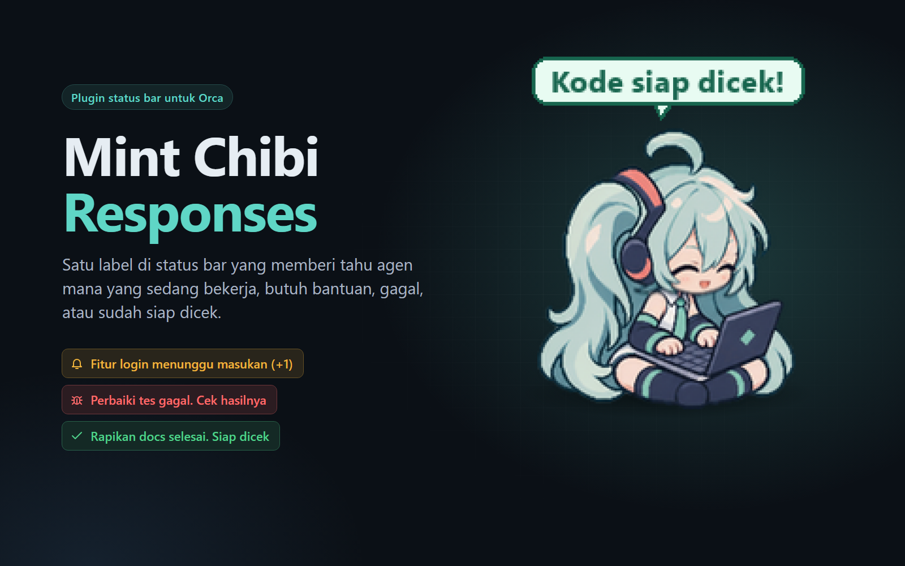
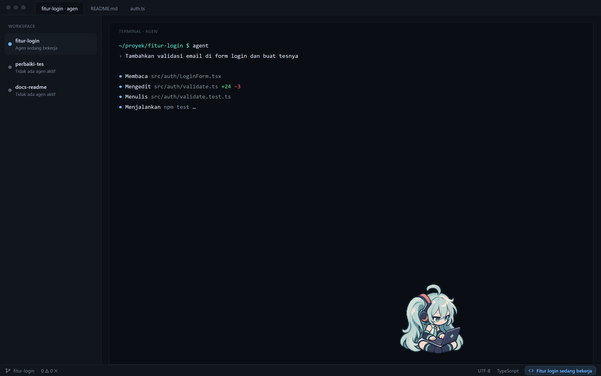
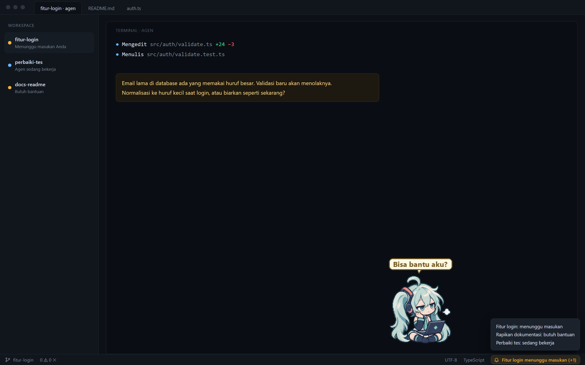
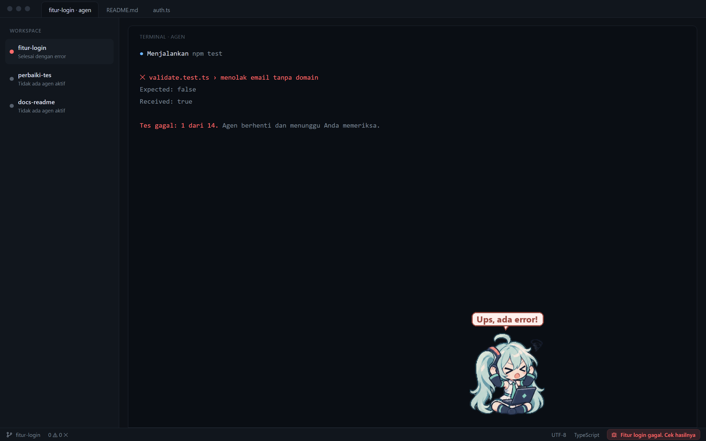
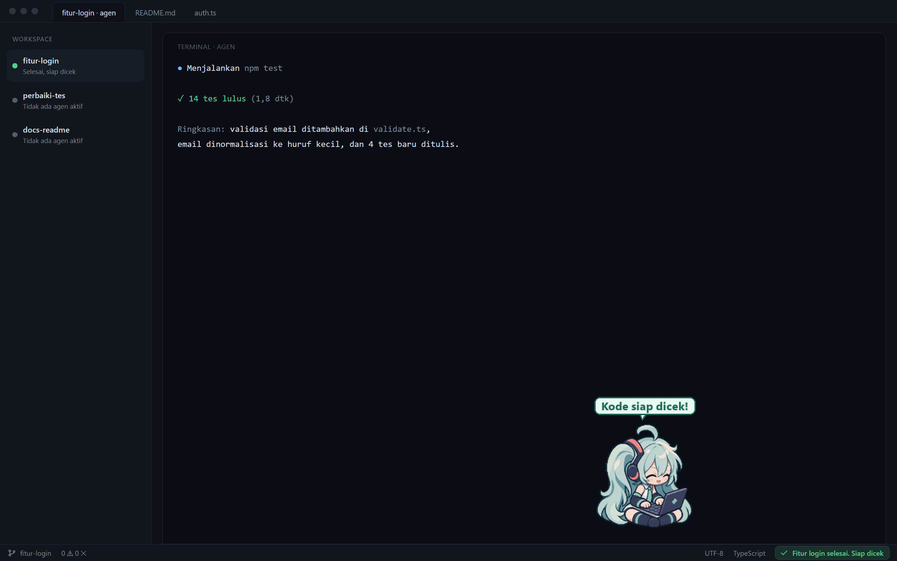

# Mint Chibi Coding

**Pet pixel art untuk Orca ADE.** Mint Chibi menemani agen saat ngoding dan bereaksi ketika Anda perlu turun tangan.

**[Unduh paket pet](https://github.com/adiityaastr/mint-chibi-coding/releases/download/v1.0.0/Mint-Chibi-Coding.zip)** · [Buka GIF ukuran penuh](./Mint-Chibi-Coding-preview.gif) · [Lihat plugin di Orca](https://api.onorca.dev/plugins/adiityaastr/mint-chibi-coding)

## Ekspresi Mint Chibi

| Status | Tampilan pet |
| --- | --- |
| Santai | Membaca layar, berkedip, lalu sesekali mengetuk satu tombol. |
| Sedang bekerja | Mengetik dengan kedua tangan di dekat keyboard. |
| Menunggu masukan | Tampak bingung dan menampilkan **“Bisa bantu aku?”** |
| Error | Bereaksi kaget dan menampilkan **“Ups, ada error!”** |
| Selesai | Tersenyum lega dan menampilkan **“Kode siap dicek!”** |

## Pasang pet di Orca Desktop

1. [Unduh dan ekstrak ZIP](https://github.com/adiityaastr/mint-chibi-coding/releases/download/v1.0.0/Mint-Chibi-Coding.zip). Folder `Mint-Chibi-Coding.codex-pet` harus berisi `pet.json` dan `spritesheet.webp`.
2. Di status bar Orca, buka **Pet → Import .codex-pet bundle…** dan pilih folder yang langsung berisi kedua file tadi. Jika menu Pet belum terlihat, cari opsi **Pet** di **Settings → Experimental**. Lokasinya dapat berbeda menurut versi Orca.
3. Pilih **Mint Chibi Coding** dari menu Pet.

**Memperbarui pet.** Ekstrak dan impor paket terbaru, lalu pilih entri yang baru diimpor. Orca menyimpan salinan file saat impor.

## Hubungkan dengan agen Anda

Mint Chibi mengikuti status yang dilaporkan agen ke Orca. Ini berlaku untuk Codex, Claude Code, dan agen lain selama integrasinya melaporkan status. Paket pet dan plugin tidak memerlukan API key tambahan.

1. Pasang dan autentikasi CLI agen pilihan Anda. Jalankan agen dari workspace Orca. Jika tersedia, gunakan launcher agen bawaan Orca.
2. Pastikan **Settings → Agents → Agent status hooks** aktif. Buka sesi agen baru jika Anda baru memasang agen atau mengubah pengaturannya.
3. Coba tugas sederhana, misalnya meminta agen merangkum sebuah file. Pet akan mengetik saat Orca mendeteksi agen bekerja. Gelembung muncul ketika Orca menerima status yang sesuai.
4. Untuk CLI kustom, cek dulu apakah perubahan status terlihat di Orca. Mint Chibi tetap bisa ditampilkan meski CLI itu belum melaporkan status.

[Dokumentasi agent status hooks Orca](https://github.com/stablyai/orca/blob/main/docs/site/content/docs/agents/hooks-memory.mdx)

## Tambahkan pesan di status bar

**Mint Chibi Responses** adalah plugin opsional untuk Orca Desktop **1.4.248+**. Plugin berjalan sebagai worker lokal dan meminta akses `agent:read` untuk menerima perubahan status agen. Gelembung pada pet sudah termasuk di paket sprite.

Saat beberapa agen berjalan, status bar memprioritaskan agen yang menunggu masukan atau terhambat. Jika lebih dari satu agen butuh perhatian, label menampilkan jumlah tambahan dan tooltip merinci status agen.

**[Tonton video demo (24 detik, MP4)](https://github.com/adiityaastr/mint-chibi-coding/releases/download/v1.0.3/mint-chibi-responses-demo.mp4)**

| Sedang bekerja | Menunggu masukan |
| --- | --- |
|  |  |
| **Gagal** | **Selesai** |
|  |  |

<strong>Pasang dari katalog Orca</strong>

Buka **Settings → Plugins**, cari **Mint Chibi Responses**, lalu tinjau akses dan pilih **Install**. Jika plugin belum muncul, cek halaman katalog atau gunakan pemasangan dari GitHub.

[Halaman plugin di katalog Orca](https://api.onorca.dev/plugins/adiityaastr/mint-chibi-coding)

<strong>Pasang dari GitHub atau folder lokal</strong>

Untuk memasang versi yang ditag:

~~~sh
orca plugin install adiityaastr/mint-chibi-coding@v1.0.3
~~~

Untuk memasang dari folder, unduh atau clone repo ini, lalu jalankan perintah berikut dari folder yang berisi `orca-plugin.json`:

~~~sh
orca plugin install .
~~~

Jika Orca meminta persetujuan, tinjau aksesnya dan ikuti perintah dengan fingerprint yang ditampilkan CLI. Saat aktif, status bar menampilkan **Mint Chibi siap**.

## Prompt siap salin untuk agen

Jalankan agen dari workspace Orca, lalu pilih prompt yang sesuai. Prompt ini membantu memasang pet dan menguji status agen pada sesi Anda.

<strong>Claude Code</strong>

~~~text
Bantu saya memasang Mint Chibi Coding untuk Claude Code di Orca Desktop.
Baca panduan di https://github.com/adiityaastr/mint-chibi-coding#readme dan unduh ZIP pet dari rilis GitHub resmi proyek. Periksa bahwa paket yang diekstrak memiliki pet.json dan spritesheet.webp. Impor lewat menu Pet Orca jika Anda memiliki akses GUI. Jika menu harus saya gunakan sendiri, berikan lokasi folder yang harus saya pilih.

Bantu cek apakah Agent status hooks aktif, lalu uji status bekerja dengan merangkum README proyek. Setelah itu, minta saya memilih satu dari dua opsi pengujian melalui fitur pertanyaan interaktif jika tersedia, supaya saya dapat melihat apakah Orca menampilkan status menunggu. Jelaskan bagian yang berhasil diuji dan apa yang perlu saya lihat langsung di Orca. Plugin status bar bersifat opsional dan hanya dipasang jika saya memintanya.
~~~

<strong>Codex</strong>

~~~text
Saya menjalankan Codex di Orca Desktop. Bantu saya memasang pet Mint Chibi Coding dari https://github.com/adiityaastr/mint-chibi-coding#readme. Unduh dan ekstrak ZIP, periksa pet.json dan spritesheet.webp, lalu gunakan menu impor pet Orca jika bisa diakses. Jika perlu tindakan manual, sebutkan menu dan jalur foldernya.

Untuk menguji animasi, baca dan rangkum README tanpa mengubah file, lalu gunakan fitur pertanyaan interaktif jika tersedia dan tunggu jawaban saya. Laporkan status Orca yang bisa Anda verifikasi serta status yang harus saya amati sendiri. Jika pesan menunggu tidak muncul, periksa integrasi status Codex di Orca sebelum mengusulkan perubahan. Pasang plugin pesan status bar hanya jika saya memintanya.
~~~

<strong>Agen CLI lain</strong>

~~~text
Bantu saya memakai Mint Chibi Coding dengan agen CLI ini di Orca Desktop. Ikuti panduan https://github.com/adiityaastr/mint-chibi-coding#readme untuk mengunduh, mengekstrak, dan mengimpor paket pet. Jika Anda tidak bisa mengakses GUI, beri saya lokasi folder dan langkah impor.

Periksa apakah Orca menerima status agen ini. Untuk tes bekerja dan selesai, rangkum sebuah file yang sudah ada tanpa mengubah workspace. Jika sesi mendukung pertanyaan interaktif, ajukan satu pertanyaan dan tunggu jawaban untuk menguji status menunggu. Jika Orca tidak menerima status tertentu, jelaskan fitur yang masih bisa saya gunakan dan apa yang belum terverifikasi. Pasang plugin pesan status bar hanya jika saya memintanya.
~~~

## Pemecahan masalah

| Masalah | Yang perlu dicek |
| --- | --- |
| Pet tidak bisa diimpor | Ekstrak ZIP terlebih dahulu. Pilih folder yang langsung berisi `pet.json` dan `spritesheet.webp`. |
| Pet tampil, tetapi ekspresi tidak berubah | Cek apakah Orca menampilkan status agen dan pastikan **Agent status hooks** aktif. |
| Pesan status bar tidak muncul | Cek apakah plugin sudah aktif. Lihat log dengan `orca plugin logs adiityaastr.mint-chibi-responses`, atau gunakan ID `local.mint-chibi-responses` jika dipasang dari folder. |
| Error atau sukses tidak terdeteksi | Agen perlu melaporkan hasilnya ke Orca. Penyelesaian tanpa hasil terkonfirmasi menggunakan pesan netral. |

## Lisensi

[Lisensi MIT](./Mint-Chibi-Responses/LICENSE) berlaku untuk kode plugin respons. Hak atas artwork pet berada di luar lisensi kode tersebut.
